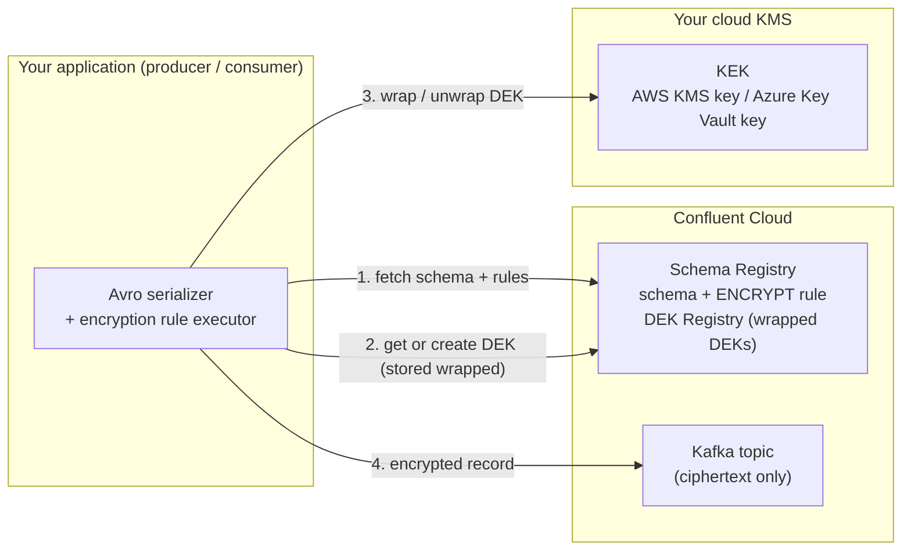

# Client-Side Encryption for Apache Kafka on Confluent Cloud, fully in Terraform

Two working, end-to-end examples of encrypting data **in the client, before it ever reaches Kafka**:

| | **CSFLE** (Client-Side Field Level Encryption) | **CSPE** (Client-Side Payload Encryption) |
|---|---|---|
| What is encrypted | Only fields tagged `PII` | The entire serialized message |
| Schema Registry rule | `domainRules`, type `ENCRYPT` | `encodingRules`, type `ENCRYPT_PAYLOAD` |
| Consumer without KMS access sees | Every non-PII field in plaintext, PII as ciphertext | Nothing usable |
| Good for | Mixed data where many teams need the non-sensitive part (analytics, routing, stream processing) | Data where the whole event is sensitive (payments, health), or you do not want to maintain field tags |
| KMS in this repo | **AWS KMS** | **Azure Key Vault** |
| Topic in this repo | `<prefix>-customers` | `<prefix>-payments` |

Everything is provisioned by Terraform: the Confluent Cloud environment, cluster, service accounts, RBAC, topics, schemas, **encryption rules, PII tag and KEKs**, plus the AWS KMS key and IAM role and the Azure Key Vault, key and Entra app. No clicking around in a console and no `curl` calls to register rules.

A Python producer/consumer pair and an end-to-end test prove it works, including an **"intruder" consumer** that has full Kafka and Schema Registry access but no KMS access.

---

## How it works (envelope encryption)



1. The data contract in Schema Registry tells the client **what** to encrypt (PII-tagged fields, or the whole payload) and **with which KEK**.
2. The client encrypts with a **DEK** (data encryption key, AES-256-GCM). The DEK is stored in the Schema Registry **DEK Registry**, but only in **wrapped** (encrypted) form.
3. Wrapping and unwrapping the DEK needs the **KEK**, which never leaves *your* KMS. The KEKs here are created with `shared = false`, so **Confluent has no access to them**.
4. Only ciphertext reaches the brokers, disks, replicas, backups, mirrors and every downstream copy.

The application code does not change between use cases. It registers the rule executors once and passes KMS credentials (see [`clients/common.py`](clients/common.py)). Everything else comes from the data contract.

---

## Prerequisites

- A Confluent Cloud account and a **Cloud resource management API key** (OrganizationAdmin or EnvironmentAdmin). The demo creates an environment with the **Stream Governance Advanced** package, which both features require.
- Terraform >= 1.6, Python >= 3.10, `make`.
- **For CSFLE:** an AWS account and credentials (`aws sso login`, a profile, or env vars) that can create a KMS key and an IAM role.
- **For CSPE:** an Azure subscription (`az login`) where you can create a resource group and Key Vault, assign roles, and register an Entra ID application.

Only have one cloud? Set `enable_csfle = false` or `enable_cspe = false`.

## Quick start

```bash
git clone <this repo> && cd <this repo>

cp .env.example .env                                         # add your Confluent Cloud API key
cp terraform/terraform.tfvars.example terraform/terraform.tfvars   # set prefix, profile, subscription, tags

make plan      # review the plan
make apply     # ~5 min; writes clients/config.json (git-ignored)
make test      # full end-to-end check of both use cases
```

Then explore by hand:

```bash
make csfle-produce     # 5 customers, PII encrypted with AWS KMS
make csfle-consume     # authorised consumer: plaintext
make csfle-intruder    # no KMS access: PII is ciphertext, the rest still readable

make cspe-produce      # 5 payments, whole payload encrypted with Azure Key Vault
make cspe-consume      # authorised consumer: plaintext
make cspe-intruder     # no KMS access: nothing readable

make destroy           # tear it all down
```

Open the topics in the Confluent Cloud console too. Message browsing shows exactly what the intruder sees.

## What you will see

**CSFLE**: the same record, seen by two consumers with identical Kafka permissions:

```text
$ make csfle-consume          # has access to the AWS KMS key
<- [plaintext] {"customer_id": "94eaea24-0", "full_name": "Grace Hamilton", "country": "DE",
                "email": "grace.hamilton@example.com", "ssn": "186-85-6666", "card_number": "4111 0029 6694 9475", ...}

$ make csfle-intruder         # Kafka + Schema Registry access, but no KMS access
failed to decrypt with kek mblumberg-csfle-kek and kms key id arn:aws:kms:eu-central-1:...
<- [no KMS access] {"customer_id": "94eaea24-0", "full_name": "Grace Hamilton", "country": "DE",
                "email": "AAAAAAHBnnUSni5ZgAsMLRJZY1v6uuho8/QVhbE2JwqxRvehXXf9gKbeuwxN5ssjh0CT...",
                "ssn": "AAAAAAF66NJlP58FUDPK9S6ifCQazPDnpKYeKo7mRpIEeL0t/JD8pOTPywc=",
                "card_number": "AAAAAAEUpGBYoRFC+K6eusTyztCZ+mBOqAMlvRHVpsE5wEw3w4ZSbvrQ84AdIhfm...", ...}
```

**CSPE**: without the Azure Key Vault key there is nothing to read, not even field names:

```text
$ make cspe-consume
<- [plaintext] {"payment_id": "t5a1a034-1", "customer_id": "cust-4574", "amount": 798.04, "currency": "GBP",
                "merchant": "Coffee Lab", "iban": "DE98740109683629537482", ...}

$ make cspe-intruder
failed to decrypt with kek mblumberg-cspe-kek and kms key id https://mblumberg-cspe-f647.vault.azure.net/keys/...
<- [no KMS access] cannot decrypt -> payload is unreadable (EOFError)
   raw bytes on the wire (105 B): 00 00 01 86 a1 35 63 d5 da 44 20 e7 b8 e2 a4 72 46 ec a4 ba 66 f4 57 d0 ...
```

**End-to-end test** (`make test`):

```text
=== CSFLE: field-level encryption with AWS KMS ===
  PASS  consumer with KMS received all 5 records
  PASS  every record decrypts back to exactly what was produced
  PASS  raw bytes on the broker contain no plaintext email / SSN / card number
  PASS  non-PII fields (full_name) are still plaintext on the wire (field-level, not payload)
  PASS  consumer WITHOUT KMS can still deserialize the record (onFailure NONE on read)
  PASS  ... but every PII field it sees is ciphertext
  PASS  ... and the non-PII fields are readable
  PASS  DEK registered under KEK mblumberg-csfle-kek

=== CSPE: payload encryption with Azure Key Vault ===
  PASS  consumer with KMS received all 5 records
  PASS  every record decrypts back to exactly what was produced
  PASS  raw bytes contain NONE of the field values (payment_id, merchant, IBAN, currency)
  PASS  consumer WITHOUT KMS still receives the 5 messages
  PASS  ... but cannot read a single field of the payload
  PASS  DEK registered under KEK mblumberg-cspe-kek

ALL CHECKS PASSED
```

## The Terraform that matters

**CSFLE**: a domain rule that encrypts every field tagged `PII` ([`terraform/csfle_aws.tf`](terraform/csfle_aws.tf)):

```hcl
resource "confluent_schema_registry_kek" "csfle" {
  name       = "${var.prefix}-csfle-kek"
  kms_type   = "aws-kms"
  kms_key_id = aws_kms_key.csfle[0].arn
  shared     = false # Confluent gets NO access to the key
  ...
}

resource "confluent_schema" "customers" {
  subject_name = "${local.csfle_topic}-value"
  schema       = file("schemas/customer.avsc") # fields carry "confluent:tags": ["PII"]
  ruleset {
    domain_rules {
      name       = "encrypt-pii"
      kind       = "TRANSFORM"
      type       = "ENCRYPT"
      mode       = "WRITEREAD"
      tags       = ["PII"]
      params     = { "encrypt.kek.name" = confluent_schema_registry_kek.csfle[0].name }
      on_failure = "ERROR,NONE" # never write plaintext; readers without KMS get ciphertext
    }
  }
}
```

**CSPE**: the same idea as an *encoding* rule over the whole payload ([`terraform/cspe_azure.tf`](terraform/cspe_azure.tf)):

```hcl
ruleset {
  encoding_rules {
    name   = "encrypt-payload"
    kind   = "TRANSFORM"
    type   = "ENCRYPT_PAYLOAD"
    mode   = "WRITEREAD"
    params = { "encrypt.kek.name" = confluent_schema_registry_kek.cspe[0].name }
  }
}
```

**Client side**: the only encryption-specific code ([`clients/common.py`](clients/common.py)):

```python
FieldEncryptionExecutor.register()  # ENCRYPT          (CSFLE)
EncryptionExecutor.register()       # ENCRYPT_PAYLOAD  (CSPE)
AwsKmsDriver.register()
AzureKmsDriver.register()

AvroSerializer(sr_client, conf={"auto.register.schemas": False, "use.latest.version": True},
               rule_conf={"role.arn": "<IAM role that may use the KMS key>"})          # AWS
               # or {"tenant.id": ..., "client.id": ..., "client.secret": ...}         # Azure
```

## What gets created

All names start with `var.prefix`. AWS and Azure resources carry `var.tags`.

| Where | Resources |
|---|---|
| Confluent Cloud | Environment (Stream Governance Advanced), Basic Kafka cluster, 2 service accounts (Terraform manager, client app) with API keys, Kafka ACLs and Schema Registry RBAC, topics `<prefix>-customers` / `<prefix>-payments`, schemas with rules, `PII` tag, 2 KEKs |
| AWS (CSFLE) | KMS key + alias, IAM role `<prefix>-cse-csfle-kms-client` allowed to Encrypt/Decrypt with that key only |
| Azure (CSPE) | Resource group, Key Vault (RBAC mode), RSA-3072 key, Entra ID app + service principal + secret with **Key Vault Crypto User** on that key only |

The client service account can read and write the topics and read the schemas, but it **cannot decrypt anything** by itself. Decryption needs the KMS identity. That separation is the point: Kafka admins, Confluent operators, or anyone holding a Kafka API key do not automatically see sensitive data.

**Cost:** a Basic cluster and the Stream Governance Advanced package bill per hour/usage, a KMS key is about $1/month, and Key Vault operations cost cents. Run `make destroy` when you are done.

## Taking it to production

This is a demo. Before you copy it:

- **Use workload identity, not secrets.** On AWS, give pods/instances an IAM role (IRSA, EKS Pod Identity, instance profile) and drop `role.arn` entirely. On Azure, use managed identity / workload identity (the driver falls back to `DefaultAzureCredential`) instead of a client secret.
- **Split producer and consumer identities.** Here one client identity does both. In production, producers usually only need `Encrypt`/`GenerateDataKey` (wrap), and only specific consumers get `Decrypt` (unwrap).
- **Decide who may decrypt in Confluent Cloud.** With `shared = false`, managed services (Flink, managed connectors) cannot read the encrypted fields. Use a shared KEK if those services must process them.
- **Plan key rotation.** `encrypt.dek.expiry.days` rotates DEKs automatically (set to 30 for CSFLE here). Rotate KEKs in the KMS (AWS automatic rotation is on).
- **State contains secrets.** API keys and the Azure client secret are in Terraform state. Use a remote, encrypted backend with tight access.
- **Choose `onFailure` deliberately.** `ERROR,NONE` hands ciphertext to readers that cannot decrypt. `ERROR,ERROR` makes them fail instead.
- **Key Vault purge protection** is off here so `destroy` is clean. Turn it on for real workloads.

## Repository layout

```
terraform/
  confluent.tf        shared Confluent core: env, cluster, SAs, API keys, RBAC
  csfle_aws.tf        CSFLE: AWS KMS key + IAM role, PII tag, KEK, topic, schema + ENCRYPT rule
  cspe_azure.tf       CSPE: Key Vault + key + Entra app, KEK, topic, schema + ENCRYPT_PAYLOAD rule
  schemas/            Avro schemas (customer.avsc has the PII tags)
  outputs.tf          client_config output -> clients/config.json
clients/
  common.py           rule executors, KMS drivers, KMS credentials
  demo.py             produce / consume / --no-kms CLI
  e2e_test.py         end-to-end assertions for both use cases
scripts/
  delete_deks.py      destroy-time helper: removes runtime-created DEKs so KEKs can be deleted
Makefile              plan / apply / test / demo targets / destroy
```

## Troubleshooting

- **`401 Unauthorized` from the Confluent provider:** run Terraform through `make` (it loads `.env`), or `set -a; source .env; set +a` first.
- **`Basic Clusters can not use resource roles`:** that is why Kafka access here uses ACLs. Schema Registry and KEK permissions use RBAC, which works on every cluster type.
- **`403` creating the Key Vault key:** Azure RBAC propagation took longer than the built-in 60 s wait. Run `make plan && make apply` again.
- **`401`/`403` from Kafka or Schema Registry right after apply:** new API keys and role bindings take a minute to propagate. Retry.
- **`Failed to decrypt with all KEKs` / `AccessDenied` on the authorised consumer:** your AWS base credentials must be allowed to `sts:AssumeRole` into the client role (an admin SSO role is), and for Azure check that the role assignment on the key exists.

- **`One or more references exist to the key` (42272) on destroy:** a KEK cannot be deleted while DEKs exist. The `terraform_data.dek_cleanup` resources delete them automatically; if you removed those, run `scripts/delete_deks.py` by hand.

## References

- [Course: Client-side Field Level Encryption](https://developer.confluent.io/courses/csfle/csfle-overview/)
- [Docs: Client-Side Field Level Encryption](https://docs.confluent.io/cloud/current/security/encrypt/csfle/overview.html)
- [Docs: Client-Side Payload Encryption](https://docs.confluent.io/cloud/current/security/encrypt/cspe.html)
- [confluentinc/csfle-examples](https://github.com/confluentinc/csfle-examples)
- [pneff93/csfle](https://github.com/pneff93/csfle) (CSFLE and CSPE examples in many languages)
- [Terraform provider: `confluent_schema`](https://registry.terraform.io/providers/confluentinc/confluent/latest/docs/resources/confluent_schema), [`confluent_schema_registry_kek`](https://registry.terraform.io/providers/confluentinc/confluent/latest/docs/resources/confluent_schema_registry_kek)

## License

[Apache 2.0](LICENSE)
